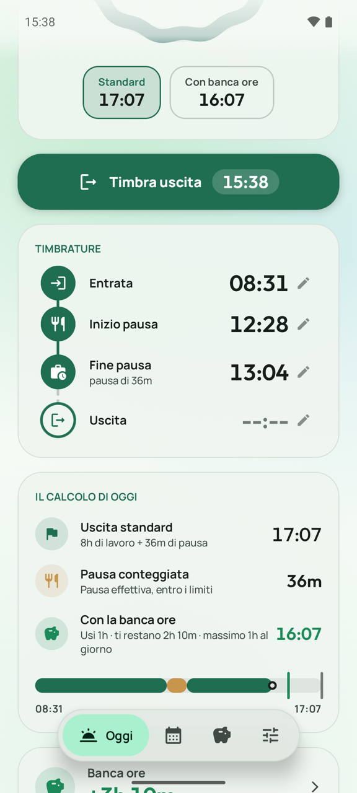
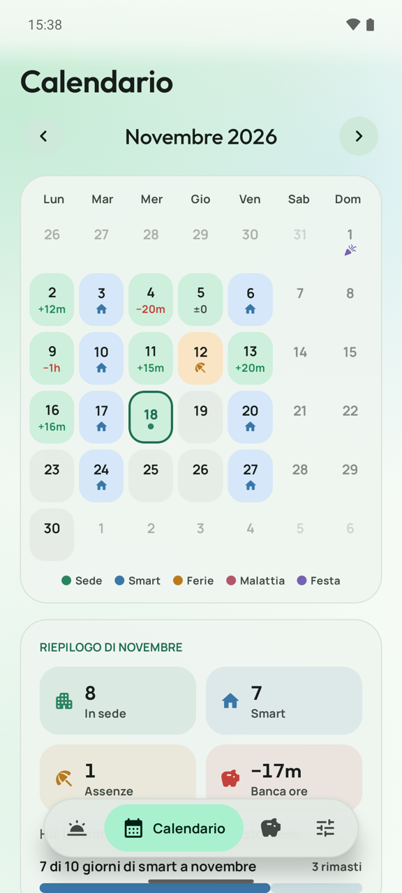
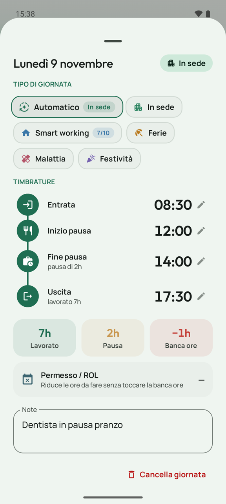
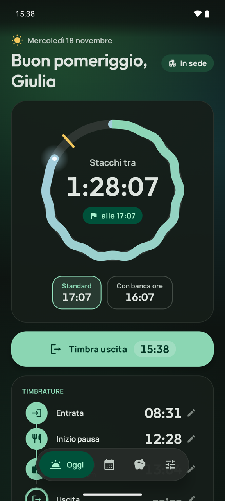
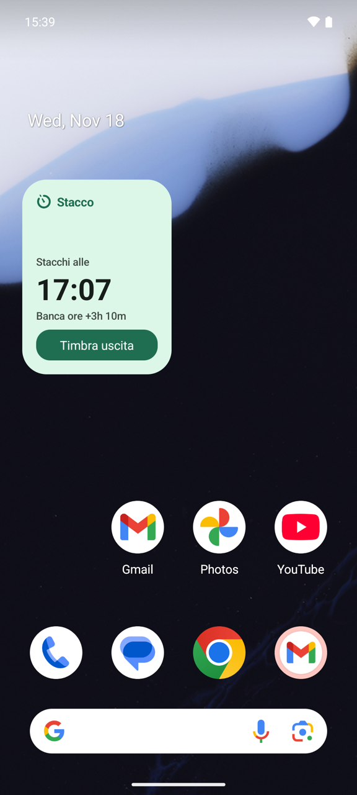

<div align="center">


# Stacco

**Il tuo tempo, finalmente chiaro.**

Timbrature, pausa pranzo e banca ore in un'unica app Android, calma e piena di animazioni.<br/>
Sai sempre a che ora puoi *staccare*.

<a href="https://github.com/Perruzz/Stacco/releases/latest/download/Stacco.apk">
  
</a>

<br/><br/>

[](https://github.com/Perruzz/Stacco/releases/latest)
[](https://github.com/Perruzz/Stacco/actions/workflows/android.yml)


[](LICENSE)

</div>

---

<div align="center">
<table>
  <tr>
    <td></td>
    <td></td>
    <td></td>
    <td></td>
  </tr>
  <tr>
    <td></td>
    <td></td>
    <td></td>
    <td></td>
  </tr>
</table>
</div>

## ✨ Cosa fa

### ⏱️ Oggi
- **Timbra con un tocco**: il pulsante grande si adatta al momento della giornata (*Timbra entrata → Vado in pausa → Rientro → Timbra uscita*), con vibrazione, animazione e possibilità di **annullare**.
- **Anello della giornata** che si riempie mentre lavori e "scorre" come acqua; durante la pausa diventa color sabbia e si calma.
- **Conto alla rovescia live** allo stacco, con l'ora di uscita sempre in vista.
- Tutti gli orari si possono correggere toccandoli, con un **selettore a rotella 3D** che "ticchetta" sotto il dito.
- **Il calcolo di oggi**:
  - **Uscita standard** = entrata + ore giornaliere + pausa conteggiata.
  - **Pausa conteggiata**: se non timbri la pausa si applica la minima; se è più corta della minima conta comunque la minima; se supera la massima, i minuti in più vengono presi dalla banca ore.
  - **Con la banca ore**: con saldo positivo ti dice quanto prima puoi uscire, rispettando le **ore minime** giornaliere; con saldo negativo ti dice fino a che ora restare per recuperare (e quanto recuperare al giorno fino a fine mese).
  - **Uscita minima**: l'orario più presto consentito dalle ore minime.
- Giornata conclusa? **Coriandoli** 🎉, ore lavorate e saldo della giornata.

### 📅 Calendario
- Mese sfogliabile con celle animate: **in sede, smart working, ferie, malattia, festività** (feste nazionali italiane incluse, Pasquetta e 4 ottobre compresi).
- Ogni giorno in sede mostra il **saldo della giornata** (+12m, −20m…).
- Tocca un giorno per vedere/modificare **le timbrature**, aggiungere un **permesso/ROL** o una nota.
- **Quota smart working** del mese (o della settimana) con avviso quando superi il limite del contratto.
- Riepilogo mensile: giorni in sede, smart, assenze, ore lavorate e saldo del mese.

### 🐷 Banca ore
- Saldo attuale con **grafico** degli ultimi 30/90 giorni.
- **Scadenze**: quanto ti scade e quando, quanti giorni in sede ti servono per usarlo tutto.
- **Movimenti**: ogni giornata, rettifica manuale (es. straordinario approvato), azzeramenti e scadenze.
- Imposta il saldo in qualsiasi momento per allinearti a quello aziendale.

### 🔔 Notifiche, widget e scorciatoie
- **Promemoria di stacco** (all'orario o 5/10/15 minuti prima), con il pulsante *Timbra uscita* direttamente nella notifica.
- **Notifica live** con conto alla rovescia e barra di avanzamento a segmenti (lavoro / pausa / lavoro); su Android 16+ diventa un *Live Update* con il countdown nella barra di stato.
- **Avvisi intelligenti sulla banca ore**: se sei in negativo ti avvisa *prima della fine del mese*; se hai ore positive in scadenza ti avvisa *prima della fine del periodo*. L'anticipo dell'avviso **dipende da quante ore hai**: più ore da recuperare o da usare → prima ti avvisa.
- **Widget** per la home con orario di uscita, saldo e pulsante *Timbra*.
- **Riquadro Impostazioni rapide** "Timbra" e scorciatoia sull'icona (pressione prolungata → *Timbra adesso*).

### 🎨 Esperienza
- Splash animato (l'anello si disegna, la lancetta gira, spunta la foglia), onboarding guidato, aurora verde che "respira" sullo sfondo, forme che si trasformano, numeri che scorrono come un contachilometri, molle e rimbalzi ovunque.
- **Tema chiaro, scuro o di sistema**, con passaggio animato a cerchio che parte dal pulsante. Colori dinamici Material You opzionali.
- **Italiano e inglese**.

## 🏢 Adatta alle regole della *tua* azienda

Ogni azienda ha le sue regole: in Stacco sono tutte impostabili.

| Impostazione | Esempio | Effetto |
| --- | --- | --- |
| Ore giornaliere | 8h | Orario di uscita standard |
| Ore minime | 7h | Massimo utilizzo giornaliero della banca ore (8h − 7h = 1h) |
| Giorni lavorativi | Lun–Ven | Calendario, giorni in sede rimanenti |
| Festività italiane | Sì | Le feste nazionali non sono lavorative |
| Pausa minima | 30m | Una pausa 12:00 → 12:20 conta comunque 30m |
| Pausa massima | 1h 30m | Pausa 12:00 → 14:00: contano 1h 30m, i 30m in più vanno sulla banca ore |
| Scadenza saldo positivo | Trimestrale | Mai, mensile, bimestrale, trimestrale, quadrimestrale, semestrale, annuale |
| Negativo da recuperare | Entro fine mese | Avvisi di recupero; a fine mese il negativo si azzera o si riporta |
| Margine avvisi | 3 giorni | Giorni in sede di anticipo, oltre a quelli necessari |
| Smart working | 10 al mese | Oppure N a settimana |

> **Esempio** — oggi è il 14 novembre e hai 5h in banca ore con scadenza trimestrale: Stacco ti mostra *"5h scadono il 31 dicembre · uscendo fino a 1h prima ti servono 5 giorni in sede"* e ti manda una notifica quando i giorni in sede rimasti si avvicinano a quelli necessari.

## 📲 Installazione

1. Scarica **[Stacco.apk](https://github.com/Perruzz/Stacco/releases/latest/download/Stacco.apk)** dal telefono.
2. Aprilo e consenti l'installazione da questa fonte quando Android lo chiede.
3. Al primo avvio un breve onboarding ti guida nella configurazione.

Requisiti: Android 8.0 (API 26) o superiore. Ottimizzata per Android 16/17 (Pixel inclusi).

> Per avvisi puntuali al minuto, in *Impostazioni → Notifiche* consenti a Stacco "Sveglie e promemoria".

## 🔒 Privacy

Nessun account, nessun server, nessun tracciamento: **tutti i dati restano sul telefono** (e nel backup Android del tuo account, se attivo). Da *Impostazioni → Dati* puoi esportare e importare un backup JSON.

## 🛠️ Compilare dal sorgente

```bash
git clone https://github.com/Perruzz/Stacco.git
cd Stacco
./gradlew assembleDebug        # APK in app/build/outputs/apk/debug/
./gradlew testDebugUnitTest    # test del motore di calcolo
```

Serve JDK 17+ e l'Android SDK (compileSdk 37). Per un APK di release firmato crea `keystore.properties` nella root:

```properties
storeFile=keystore/stacco-release.jks
storePassword=…
keyAlias=stacco
keyPassword=…
```

e poi `./gradlew assembleRelease`.

### Stack
Kotlin 2.4 · Jetpack Compose + Material 3 · DataStore + kotlinx.serialization · WorkManager · AlarmManager · Glance (widget) · graphics-shapes (forme che si trasformano) · AGP 9.5 · Gradle 9.9

### Struttura
```
app/src/main/java/io/github/perruzz/stacco/
├── domain/      # motore di calcolo puro (giornata, banca ore, calendario, avvisi) + test
├── data/        # DataStore (JSON) e repository
├── ui/          # Compose: Oggi, Calendario, Banca ore, Impostazioni, Onboarding, componenti
├── notify/      # promemoria, notifica live, avvisi banca ore, ricevitori di sistema
├── widget/      # widget Glance
└── tile/        # riquadro Impostazioni rapide
```

Il saldo della banca ore non è mai un contatore "fragile": viene **ricalcolato da zero** a partire dalle giornate, dalle rettifiche e dalle regole aziendali, quindi correggere un orario di un mese fa aggiorna tutto in modo coerente.

## ☕ Supporta il progetto

Stacco è gratuita e open source. Se ti fa uscire in orario, puoi offrirmi un caffè ☕

<a href="https://paypal.me/citrotren"></a>

(Lo trovi anche nell'app, in *Impostazioni → Supporta Stacco*.)

## 📄 Licenza

[MIT](LICENSE) · Caratteri [Outfit](https://github.com/Outfitio/Outfit-Fonts) e [Manrope](https://github.com/davelab6/manrope) con licenza [SIL OFL 1.1](licenses/).

---

<details>
<summary>🇬🇧 English</summary>

**Stacco** (Italian for *clocking off*) is a calm, animated Android app to track badge stamps, lunch breaks and your **hour bank** (time bank / flexitime balance).

- Tap once to stamp in, start/end the lunch break and clock out; live countdown to your exit time.
- Exit time calculation with company rules: minimum and maximum lunch break, daily and minimum hours, early exit using the hour bank (capped by the minimum hours) or later exit to recover a negative balance.
- Monthly calendar with office / remote / vacation / sick / holiday days, remote-work quota and per-day details.
- Hour bank with chart, movements, manual adjustments and configurable rules (positive balance expiry per month/quarter/…; negative balance to recover by month end).
- Smart alerts whose timing adapts to how many hours you need to use or recover; exit reminders; Android 16 Live Update countdown; home screen widget; Quick Settings tile.
- Light/dark/system theme with a circular reveal, Material You colors, Italian and English.
- No account, no tracking: everything stays on your device.

Download the latest APK from the [Releases](https://github.com/Perruzz/Stacco/releases/latest) page.

</details>
