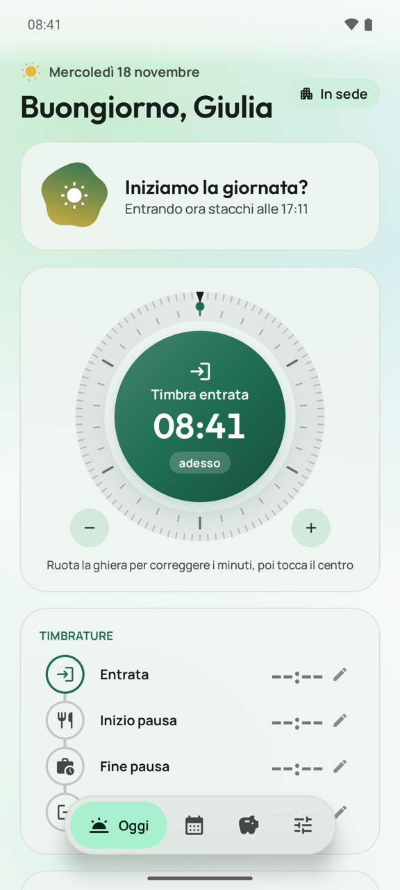
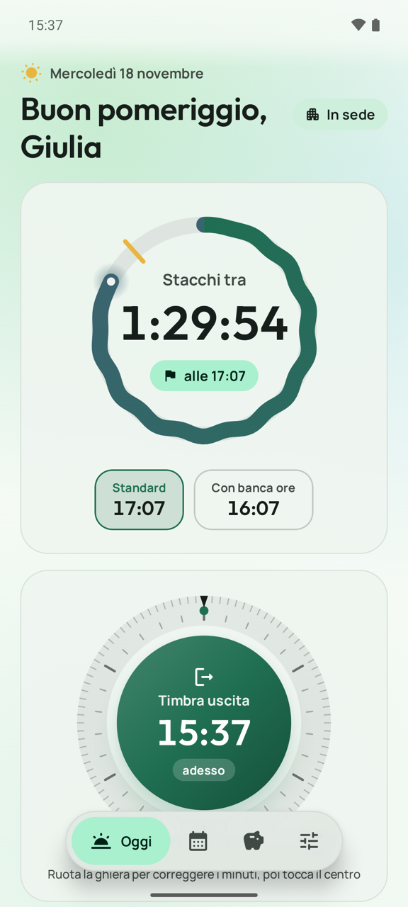
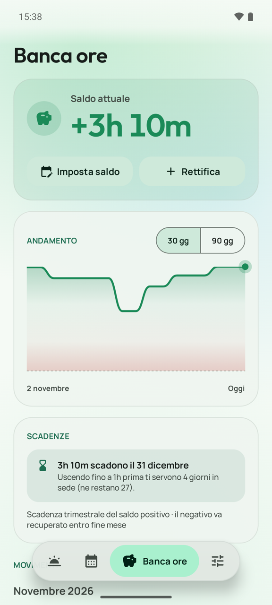
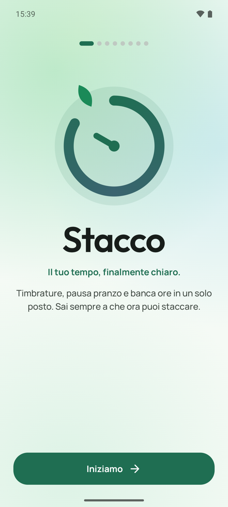
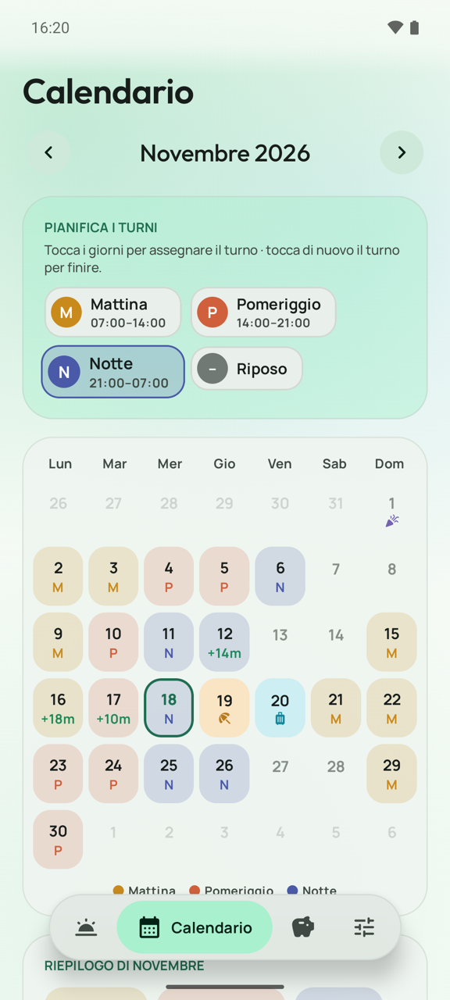
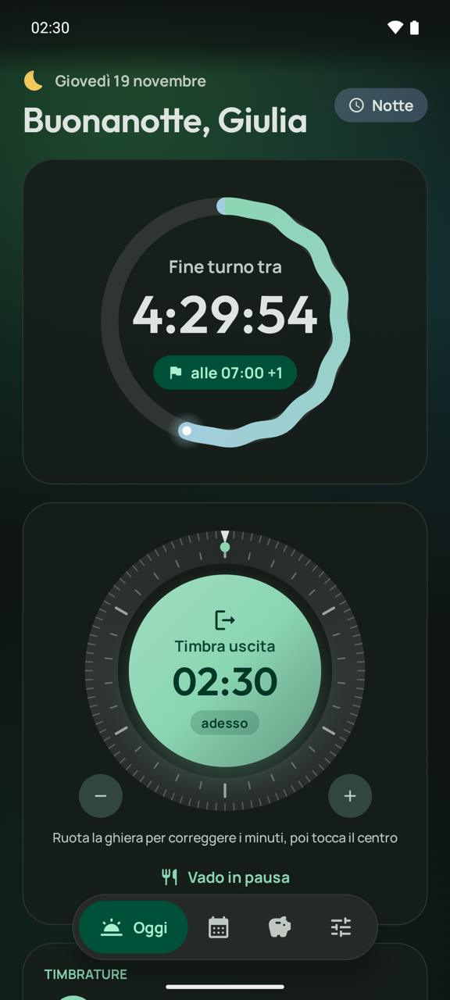

<div align="center">


# Stacco

**Il tuo tempo, finalmente chiaro.**

Timbrature, pausa pranzo, turni e banca ore in un'unica app Android, calma e piena di animazioni.<br/>
Sai sempre a che ora puoi *staccare*.

<a href="https://github.com/Perruzz/Stacco/releases/latest/download/Stacco.apk">
  
</a>

<br/><br/>

[](https://github.com/Perruzz/Stacco/releases/latest)
[](https://github.com/Perruzz/Stacco/actions/workflows/android.yml)


[](LICENSE)

</div>

---

<div align="center">
<table>
  <tr>
    <td></td>
    <td></td>
    <td></td>
    <td></td>
  </tr>
  <tr>
    <td></td>
    <td></td>
    <td></td>
    <td></td>
  </tr>
</table>
</div>

## 🚀 Novità della 2.0

La 2.0 è la versione pronta per Google Play, dopo cinque revisioni complete: calcoli, interfaccia, funzionamento in background, conformità e collaudo finale.

- **Reperibilità H24**: giorni reperibili sul calendario, timer degli interventi anche a schermo bloccato e recupero ore degli interventi, separato dalla banca ore, con un avviso prima che scadano.
- **Accessibile con TalkBack**: ogni pulsante dice cosa fa e in che stato è, la ghiera si regola come un cursore e i giorni del calendario si leggono per intero. Niente testi tagliati con i caratteri grandi, sugli schermi piccoli, in orizzontale e sui tablet.
- **Più leggera sulla batteria**: a schermo fermo l'app non ridisegna più a 120 Hz. Fuori da *Oggi* scende da 120 a circa 17 fotogrammi al secondo.
- **Promemoria che arrivano sempre**: anche senza il permesso *Sveglie e promemoria* (al massimo 2 minuti prima), in Doze e in risparmio energetico, dopo un riavvio, un aggiornamento o un cambio di fuso orario.
- **Widget e riquadro sempre aggiornati**: passano al nuovo giorno da soli, ignorano il doppio tocco e non timbrano sulle giornate di smart working o di ferie. Il widget si adatta a dimensioni e caratteri e ha l'anteprima nel selettore dei widget.
- **Calcoli a prova di casi limite**: ora legale nei turni di notte, dati danneggiati recuperati parte per parte, backup di ogni versione dalla 1.0 in poi, elenco di tutte le giornate da sistemare.
- **Pronta per Google Play**: la versione Play si aggiorna dallo store e non accede a Internet ([informativa privacy](docs/privacy.md)).

## ✨ Cosa fa

### ⏱️ Oggi
- **Timbra con la ghiera**: al centro del pulsante c'è l'ora attuale, che scorre come un orologio. Hai timbrato in azienda qualche minuto fa? **Ruota la ghiera** attorno al pulsante: ogni scatto è un minuto, con una vibrazione a ogni tacca (ci sono anche i tasti **−** e **+**). Poi tocca il centro per timbrare all'orario scelto. Se non timbri entro **10 secondi**, la ghiera torna da sola all'ora attuale, con un arco che mostra il tempo che resta.
- Il pulsante si adatta al momento della giornata (*Timbra entrata → Vado in pausa → Rientro → Timbra uscita*), con animazione e possibilità di **annullare**.
- **Anello della giornata** che si riempie mentre lavori e "scorre" come acqua; durante la pausa diventa color sabbia e si calma.
- **Conto alla rovescia live** allo stacco, con l'ora di uscita sempre in vista.
- Tutti gli orari si possono correggere toccandoli, con un **selettore a rotella 3D** che "ticchetta" sotto il dito.
- **Il calcolo di oggi**:
  - **Uscita standard** = entrata + ore giornaliere + pausa conteggiata.
  - **Pausa conteggiata**: se non timbri la pausa si applica la minima; se è più corta della minima conta comunque la minima; se è più lunga conta per intero e l'uscita si sposta di conseguenza. Nelle giornate fino a 6 ore (part-time, venerdì corto, mezza giornata di permesso) la pausa non è dovuta, come prevede la legge.
  - **Arrotondamenti**: se l'azienda arrotonda le timbrature (per esempio entrata al quarto d'ora successivo, uscita al precedente, con qualche minuto di tolleranza), Stacco conta gli orari arrotondati ovunque: conto alla rovescia, giornata, calendario, banca ore ed export. Le timbrature restano quelle vere e accanto vedi *conteggiata alle 08:15*.
  - **Con la banca ore**: con saldo positivo ti dice quanto prima puoi uscire, rispettando le **ore minime** giornaliere; con saldo negativo ti dice fino a che ora restare per recuperare (e quanto recuperare al giorno fino a fine mese).
  - **Uscita minima**: l'orario più presto consentito dalle ore minime.
  - **Con un permesso**: le ore da fare si riducono e il permesso si scala dalle ferie. Quel giorno la banca ore può scendere ma non salire: se lavori più del necessario, il permesso era in più (8h con 4h di permesso: 5h lavorate → ±0, 3h lavorate → −1h).
- Giornata conclusa? **Coriandoli** 🎉, ore lavorate e saldo della giornata.
- **Uscita dimenticata?** Se in un giorno recente c'è l'entrata ma manca l'uscita, *Oggi* te lo segnala e ti propone l'orario più probabile. Finché manca, quella giornata resta fuori dalla banca ore.

### 🩺 Lavoro a turni
Per chi non ha un orario fisso (infermieri, OSS, operai, vigilanza…): al primo avvio o in *Impostazioni* scegli **Turni** invece di *Orario fisso*.
- **Turni già pronti**: *Mattina 07–14*, *Pomeriggio 14–21* e *Notte 21–07*, senza pausa. Puoi rinominarli, cambiare orari e colore, aggiungere una pausa o crearne di nuovi.
- **Pianifica il mese** dal calendario: scegli un turno e tocca i giorni per assegnarlo (o *Riposo*). Ogni giorno mostra la lettera del turno e il riepilogo conta turni e ore previste.
- **Turni di notte** a cavallo della mezzanotte: la giornata continua dopo le 00:00 (*fine turno alle 07:00 +1*) e la timbratura d'uscita del mattino finisce nel turno giusto.
- La schermata *Oggi* ti mostra il turno del giorno, il conto alla rovescia alla fine turno e il saldo se esci in orario; minuti in più o in meno vanno in banca ore.
- **Promemoria di inizio turno** 30 minuti prima, con il nome del turno e l'orario.

### 📅 Calendario
- Mese sfogliabile con celle animate: **in sede, smart working, trasferta, ferie, malattia, festività** (feste nazionali italiane incluse, Pasquetta e 4 ottobre compresi, più il **Santo Patrono** della tua città se lo imposti).
- **Trasferta**: come lo smart working, non serve timbrare; la giornata vale come lavorata e la banca ore resta ferma.
- Ogni giorno in sede mostra il **saldo della giornata** (+12m, −20m…).
- Tocca un giorno per vedere/modificare **le timbrature**, aggiungere un **permesso/ROL** o una nota.
- **Seleziona più giorni**: tieni premuto un giorno e trascina il dito sugli altri (oppure tocca *Seleziona più giorni*), poi scegli *Ferie*, *Smart working*, *Trasferta*… e li segni tutti insieme. Sabati, domeniche e festivi restano liberi; un messaggio con *Annulla* ti permette di tornare indietro.
- **Quota smart working** del mese (o della settimana) con avviso quando superi il limite del contratto.
- Riepilogo mensile: giorni in sede, smart, trasferte, assenze, ore lavorate e saldo del mese.
- **Esporta il mese in CSV** (pulsante nel riepilogo): una riga per giorno con tipo, turno, timbrature, permesso, pausa conteggiata, ore lavorate, previste e saldo, più i totali e la banca ore. Con gli arrotondamenti attivi ci sono anche l'entrata e l'uscita conteggiate, così ogni riga torna al minuto con il calendario. Si apre direttamente in Excel, Numbers o Fogli Google.

### 🐷 Banca ore
- Saldo attuale con **grafico** degli ultimi 30/90 giorni.
- **Scadenze**: quanto ti scade e quando, quanti giorni in sede ti servono per usarlo tutto.
- **Movimenti**: ogni giornata, rettifica manuale (es. straordinario approvato), azzeramenti e scadenze.
- Imposta il saldo in qualsiasi momento per allinearti a quello aziendale.

### 🏖️ Ferie e permessi
- Imposta le **ore di ferie dell'anno** (dal 1° gennaio al 31 dicembre): ogni giorno di ferie scala le ore giornaliere (o il turno previsto), ogni permesso le sue ore. Sabati, domeniche e festivi non costano nulla.
- Vedi le ore **disponibili oggi** (anche in giorni), quelle **godute**, quelle già **pianificate** nel calendario e quante ne **restano**.
- Il residuo passa all'anno nuovo (si può disattivare) e con *Imposta residuo* ti allinei alla busta paga.
- Mentre selezioni più giorni vedi subito quante ferie ti resterebbero.

### 📞 Reperibilità e recupero interventi
Per chi è reperibile (IT, impianti, sanità…). È un modulo **spento di default**: finché non lo accendi in *Impostazioni → Reperibilità* l'app resta identica. Se lo spegni i dati restano; un intervento ancora in corso viene chiuso in quel momento.
- **Giorni reperibili** dal calendario, dalla scheda del giorno o con la selezione multipla (weekend e festivi compresi). Il giorno può essere in sede, in smart working o di riposo: la reperibilità è un'indicazione in più, con un pallino col telefono accanto al numero del giorno.
- **Timer dell'intervento** H24: nei giorni di reperibilità *Oggi* mostra *Avvia intervento*. Il cronometro gira anche nella notifica, a schermo bloccato, con il pulsante *Termina*; se l'intervento cade durante la giornata in sede, le due notifiche restano separate, ognuna con i suoi pulsanti. Un intervento nelle prime ore dopo un giorno di reperibilità resta in quella notte (*23:30 → 00:40 +1*).
- **Quarto d'ora per eccesso**: ogni intervento è accreditato arrotondato al quarto d'ora successivo (32 minuti → 45), con accanto il tempo reale. Gli interventi si possono anche inserire o correggere a mano.
- **Recupero interventi**: un saldo **separato** dalla banca ore e dalle ferie. Lo usi in una giornata lavorativa a blocchi di 30 minuti, fino alla giornata intera: per esempio 1h lavorata + 7h di recupero fanno le 8h e la giornata va in pari senza toccare la banca ore. Con un permesso nello stesso giorno il recupero copre solo il resto della giornata, anche dopo un cambio di orario.
- **Scadenza**: le ore di ogni mese vanno usate entro la fine del secondo mese successivo (intervento a novembre → 31 gennaio). Si usano prima quelle che scadono prima, con avviso in app e notifica quando rischi di perderle.
- Nella scheda *Banca ore* trovi saldo, scadenze mese per mese e ultimi interventi; nel calendario e nell'export CSV i giorni di reperibilità, le ore maturate e quelle fruite.

### 🔔 Notifiche, widget e scorciatoie
- **Promemoria di stacco** (all'orario o 5/10/15 minuti prima), con il pulsante *Timbra uscita* direttamente nella notifica.
- **Promemoria di inizio turno** in modalità turni.
- **Notifica live** con conto alla rovescia e barra di avanzamento a segmenti (lavoro / pausa / lavoro); su Android 16+ diventa un *Live Update* con il countdown nella barra di stato. È visibile anche **a schermo bloccato** e, se la scorri via per sbaglio, ricompare subito (la spegni da *Impostazioni → Notifiche*).
- **Avvisi intelligenti sulla banca ore**: se sei in negativo ti avvisa *prima della fine del mese*; se hai ore positive in scadenza ti avvisa *prima della fine del periodo*. L'anticipo dell'avviso **dipende da quante ore hai**: più ore da recuperare o da usare → prima ti avvisa (vedi l'esempio più sotto).
- **Widget** per la home con orario di uscita, saldo e pulsante *Timbra*; si adatta alle dimensioni e ai caratteri grandi, e passa da solo al nuovo giorno.
- **Riquadro Impostazioni rapide** "Timbra" e scorciatoia sull'icona (pressione prolungata → *Timbra adesso*).
- **Avviso aggiornamenti** (versione GitHub): una volta al giorno Stacco controlla su GitHub se è uscita una nuova versione e te lo dice con una notifica, con il pulsante *Scarica*. Puoi controllare anche a mano, in fondo alle *Impostazioni*. La versione di Google Play invece si aggiorna dallo store.

### 🎨 Esperienza
- Splash animato (l'anello si disegna, la lancetta gira, spunta la foglia), onboarding guidato, aurora verde che "respira" sullo sfondo, forme che si trasformano, numeri che scorrono come un contachilometri, molle e rimbalzi ovunque.
- **Tema chiaro, scuro o di sistema**, con passaggio animato a cerchio che parte dal pulsante. Colori dinamici Material You opzionali.
- **Italiano e inglese**.

## 🏢 Adatta alle regole della *tua* azienda

Ogni azienda ha le sue regole: in Stacco sono tutte impostabili.

**Cambi di contratto.** Quando modifichi ore giornaliere, ore minime, orario per giorno, giorni lavorativi o passi tra orario fisso e turni, Stacco ti chiede *da quando* vale la modifica: da oggi, da un giorno scelto o da sempre. Ogni giornata viene calcolata con le regole in vigore quel giorno, quindi i mesi passati restano come erano e non serve reimpostare il saldo. Lo storico è in *Impostazioni → Storico dell'orario*.

| Impostazione | Esempio | Effetto |
| --- | --- | --- |
| Modalità | Orario fisso | Oppure *Turni*, con turni personalizzabili pianificati sul calendario |
| Ore giornaliere | 8h | Orario di uscita standard |
| Orario per giorno | Ven 4h | Giorni con ore diverse (settimana corta, part-time verticale) |
| Ore minime | 7h | Massimo utilizzo giornaliero della banca ore (8h − 7h = 1h) |
| Giorni lavorativi | Lun–Ven | Calendario, giorni in sede rimanenti |
| Festività italiane | Sì | Le feste nazionali non sono lavorative |
| Santo patrono | 7 dicembre | La festa del patrono della città in cui lavori, ogni anno |
| Pausa minima | 30m | Una pausa 12:00 → 12:20 conta comunque 30m (nelle giornate oltre le 6 ore) |
| Arrotondamenti | 15 min | Entrata per eccesso, uscita per difetto, tolleranza in minuti |
| Storico dell'orario | Dal 1° dicembre | Ogni modifica all'orario vale da una data: i giorni prima restano calcolati con l'orario di allora |
| Scadenza saldo positivo | Trimestrale | Mai, mensile, bimestrale, trimestrale, quadrimestrale, semestrale, annuale |
| Negativo da recuperare | Entro fine mese | Avvisi di recupero; a fine mese il negativo si azzera o si riporta |
| Anticipo extra degli avvisi | 3 giorni | Giorni in sede in più rispetto a quelli strettamente necessari |
| Smart working | 10 al mese | Oppure N a settimana |
| Ferie annue | 160h | Le scalano i giorni di ferie e le ore di permesso; il residuo passa all'anno dopo |
| Reperibilità | Spenta | Giorni reperibili, timer degli interventi e recupero ore (quarto d'ora per eccesso, scadenza a fine del 2° mese) |

> **Esempio** — oggi è il 14 novembre e hai **5h** in banca ore con scadenza trimestrale. Con 8h giornaliere e 7h minime puoi uscire al massimo 1h prima al giorno, quindi per usarle tutte ti servono **5 giorni in sede**. Stacco te lo mostra (*"5h scadono il 31 dicembre · uscendo fino a 1h prima ti servono 5 giorni in sede"*) e, con un anticipo extra di 3 giorni, ti manda la notifica quando i giorni in sede rimasti prima del 31 dicembre scendono a **8** (5 + 3).<br/>
> Vale anche per il negativo: con **−45m** da recuperare entro fine mese basta 1 giorno, quindi l'avviso arriva quando restano 4 giorni in sede.

## 📲 Installazione

1. Scarica **[Stacco.apk](https://github.com/Perruzz/Stacco/releases/latest/download/Stacco.apk)** dal telefono.
2. Aprilo e consenti l'installazione da questa fonte quando Android lo chiede.
3. Al primo avvio un breve onboarding ti guida nella configurazione (orario fisso o turni).

Quando esce una nuova versione Stacco ti avvisa: scarica l'APK e installalo sopra quello che hai, i dati restano.

Requisiti: Android 8.0 (API 26) o superiore. Ottimizzata per Android 16/17 (Pixel inclusi).

> Per avvisi puntuali al minuto, in *Impostazioni → Notifiche* consenti a Stacco "Sveglie e promemoria". Senza, i promemoria arrivano comunque, al massimo 2 minuti prima.

## 🔒 Privacy

Nessun account, nessun server, nessun tracciamento: **tutti i dati restano sul telefono** (e nel backup Android del tuo account, se attivo). Da *Impostazioni → Dati* puoi esportare e importare un backup JSON.

L'unica connessione a Internet è il **controllo degli aggiornamenti** dell'APK di GitHub: una volta al giorno Stacco chiede a GitHub qual è l'ultima versione pubblicata, senza inviare nessun dato tuo. Si disattiva da *Impostazioni → Notifiche → Avviso aggiornamenti*. La versione per Google Play non lo ha, e non accede affatto a Internet.

Informativa completa: [docs/privacy.md](docs/privacy.md).

## 🛠️ Compilare dal sorgente

```bash
git clone https://github.com/Perruzz/Stacco.git
cd Stacco
./gradlew assembleGithubDebug       # APK in app/build/outputs/apk/github/debug/
./gradlew testGithubDebugUnitTest   # test del motore di calcolo
```

Serve JDK 17+ e l'Android SDK (compileSdk 37). Per un APK di release firmato crea `keystore.properties` nella root:

```properties
storeFile=keystore/stacco-release.jks
storePassword=…
keyAlias=stacco
keyPassword=…
```

e poi:

- `./gradlew assembleGithubRelease`: l'APK pubblicato su GitHub, che controlla da solo se c'è una nuova versione;
- `./gradlew bundlePlayRelease`: l'`.aab` per Google Play, senza controllo degli aggiornamenti e senza accesso a Internet (gli aggiornamenti li porta il Play Store).

### Stack
Kotlin 2.4 · Jetpack Compose + Material 3 · DataStore + kotlinx.serialization · WorkManager · AlarmManager · Glance (widget) · graphics-shapes (forme che si trasformano) · AGP 9.5 · Gradle 9.9

### Struttura
```
app/src/main/java/io/github/perruzz/stacco/
├── domain/      # motore di calcolo puro (giornata, turni, banca ore, calendario, avvisi) + test
├── data/        # DataStore (JSON) e repository
├── ui/          # Compose: Oggi, Calendario, Banca ore, Impostazioni, Onboarding, componenti
├── notify/      # promemoria, notifica live, avvisi banca ore, ricevitori di sistema
├── widget/      # widget Glance
└── tile/        # riquadro Impostazioni rapide
```

Il saldo della banca ore non è mai un contatore "fragile": viene **ricalcolato da zero** a partire dalle giornate, dalle rettifiche e dalle regole aziendali, quindi correggere un orario di un mese fa aggiorna tutto in modo coerente.

## ☕ Supporta il progetto

Stacco è gratuita e open source. Se ti fa uscire in orario, puoi offrirmi un caffè ☕

<p align="center">
  <a href="https://buymeacoffee.com/peruzz">
    
  </a>
</p>

(Lo trovi anche nell'app, in *Impostazioni → Supporta Stacco*. Ogni tanto, mai nelle prime due settimane e al massimo una volta ogni 3–4 settimane, *Oggi* te lo ricorda con una piccola card che puoi rimandare o nascondere per sempre.)

## 📄 Licenza

[MIT](LICENSE) · Caratteri [Outfit](https://github.com/Outfitio/Outfit-Fonts) e [Manrope](https://github.com/davelab6/manrope) con licenza [SIL OFL 1.1](licenses/).

---

<details>
<summary>🇬🇧 English</summary>

**Stacco** (Italian for *clocking off*) is a calm, animated Android app to track badge stamps, lunch breaks, shifts and your **hour bank** (time bank / flexitime balance).

**What's new in 2.0**, the release ready for Google Play after five full reviews:
- **24/7 on-call duty**: on-call days, an intervention timer that also runs on the lock screen, and a recovery account kept apart from the hour bank, with a warning before the hours expire.
- **TalkBack accessible**: every control says what it does and its state, the dial adjusts like a slider, calendar days read in full; no text cut with large fonts, on small screens, in landscape or on tablets.
- **Easier on the battery**: a still screen no longer redraws at 120 Hz (about 17 frames per second outside *Today*).
- **Reminders that always come**: also without the *Alarms & reminders* permission (at most 2 minutes early), in Doze and battery saver, after a restart, an update or a time zone change.
- **Widget and tile always up to date**: they move to the new day by themselves, ignore double taps and never stamp a remote-work or vacation day; the widget adapts to its size and to large fonts, with a preview in the widget picker.
- **Calculations proof against edge cases**: daylight saving on night shifts, damaged data recovered part by part, backups of every version since 1.0, a list of every day to fix.
- **Ready for Google Play**: the Play version is updated by the store and has no Internet access ([privacy policy](docs/privacy.md)).

**Features**

- Stamp with a **rotary dial**: the button shows the current time like a clock; turn the bezel to adjust the minutes (one haptic tick per minute), then tap the centre. After 10 seconds without stamping it springs back to the current time.
- Live countdown to your exit time; exit time calculation with company rules: minimum lunch break, daily and minimum hours, early exit using the hour bank (capped by the minimum hours) or later exit to recover a negative balance.
- **Shift work** mode (nurses, factories…): customizable shifts (morning 7–14, afternoon 14–21, night 21–7 out of the box), monthly planning by tapping days, night shifts across midnight, shift start reminders.
- Monthly calendar with office / remote / business trip / vacation / sick / holiday days, remote-work quota and per-day details; press and drag to mark many days at once.
- Hour bank with chart, movements, manual adjustments and configurable rules (positive balance expiry per month/quarter/…; negative balance to recover by month end).
- Yearly vacation hours: vacation days and hours of leave are taken from them (taken, planned, left, carry-over). A day with leave can lower the hour bank but never raise it.
- Smart alerts whose timing adapts to how many hours you need to use or recover; exit reminders; Android 16 Live Update countdown, also on the lock screen; home screen widget; Quick Settings tile.
- Forgotten exit stamps are pointed out (with a suggested time), Italian holidays plus your town's patron saint's day, and in the GitHub version a daily check for new versions (its only network access; the Google Play version has none).
- Different hours per weekday (short Fridays, part-time), company rounding of badge times with tolerance, and a monthly CSV export.
- Contract changes take effect from a date you choose: every day is counted with the rules in force on that day, so past months stay as they were.
- Optional **on-call duty**: on-call days on the calendar, a 24/7 intervention timer (also on the lock screen), interventions credited by the quarter hour rounded up, and a separate recovery account that evens out a working day without touching the hour bank, to be used by the end of the second month after.
- Light/dark/system theme with a circular reveal, Material You colors, Italian and English.
- No account, no tracking: everything stays on your device.

Download the latest APK from the [Releases](https://github.com/Perruzz/Stacco/releases/latest) page.

</details>
